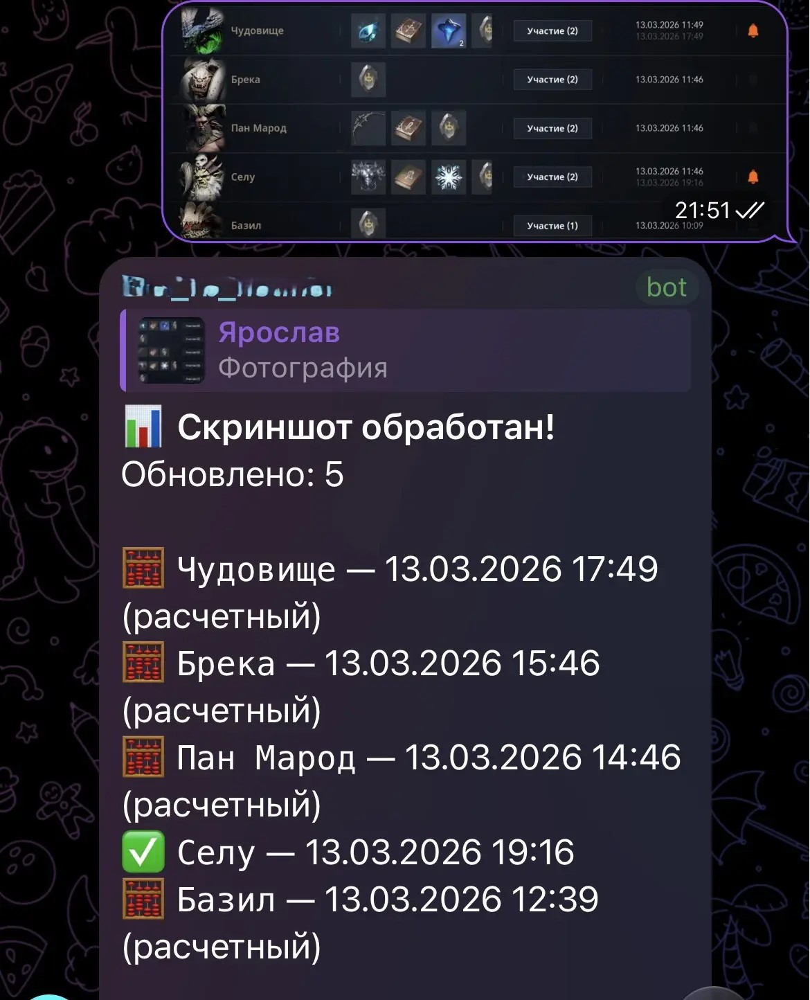
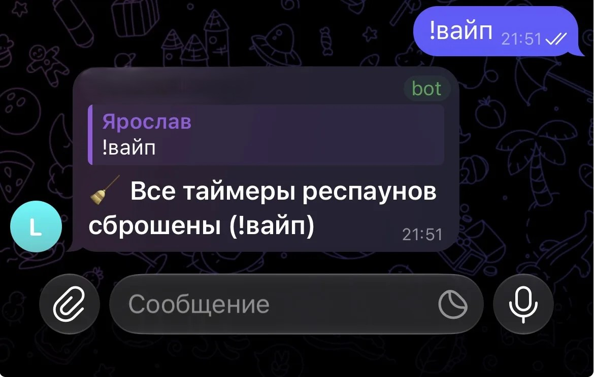
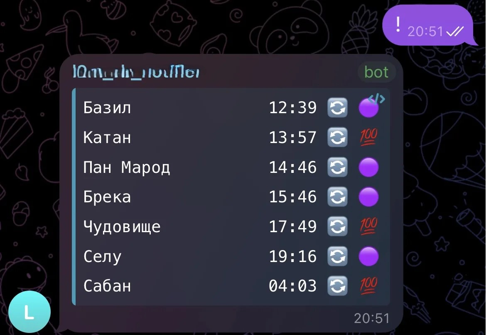
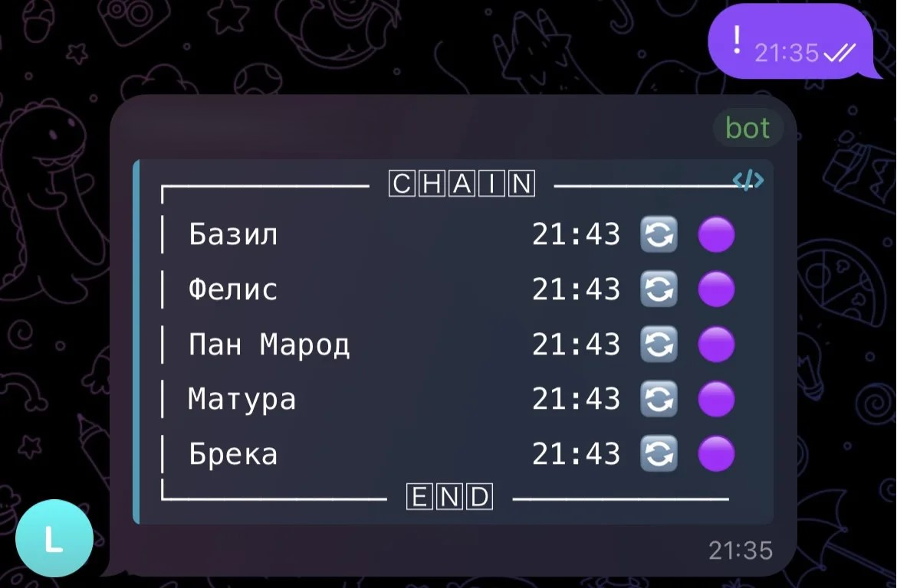

# lineage2m-telegram-rb-notifier-bot

Бот для Telegram, предназначенный для отслеживания времени респауна рейдовых боссов (RB) в игре Lineage 2M. Позволяет игрокам оперативно получать информацию о статусе боссов, фиксировать моменты их убийства и сброса таймеров, а также просматривать данные по регионам.

## Возможности

- **Отслеживание таймеров респауна**: фиксация времени убийства боссов и расчёт времени их следующего появления.
- **Группировка по регионам**: возможность просмотра боссов по отдельным локациям (например, по региону «Дион»).
- **Управление статусами**: ручное обновление статусов боссов (убит, сброшен).
- **Уведомления**: визуальное отображение актуальных данных в удобном формате для быстрого восприятия.

## Список команд

- `!` — показать список всех боссов с текущим статусом и временем респауна.
- `!дион` — показать список боссов по региону «Дион» (поддерживаются и другие регионы по аналогии).
- `+Имя` — зафиксировать, что босс с именем «Имя» убит в текущий момент времени.
- `+Имя Время` — зафиксировать, что босс с именем «Имя» убит в указанное время («Время»).
- `-Имя` — сбросить таймер для босса с именем «Имя».

## Пример использования

Пользователь отправляет команду `+Селу 19:16`, чтобы зафиксировать убийство босса Селу в 19:16. Бот обновляет таймер и отображает актуальное время следующего респауна. При использовании команды `!` бот выводит список всех боссов с их текущим статусом, включая расчётное время респауна.

Команда `!вайп` позволяет сбросить все таймеры респаунов одновременно.

## Примеры интерфейса

Бот формирует структурированные сообщения с именами боссов, временем убийства и расчётным временем респауна. В некоторых случаях используется форматирование в стиле «CHAIN» для отображения групп боссов с единым временем респауна.

